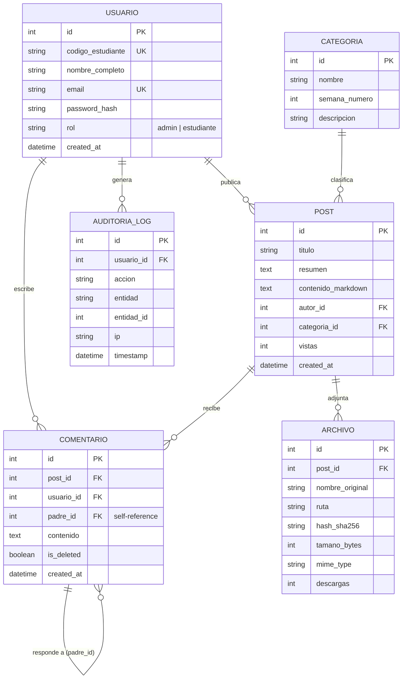
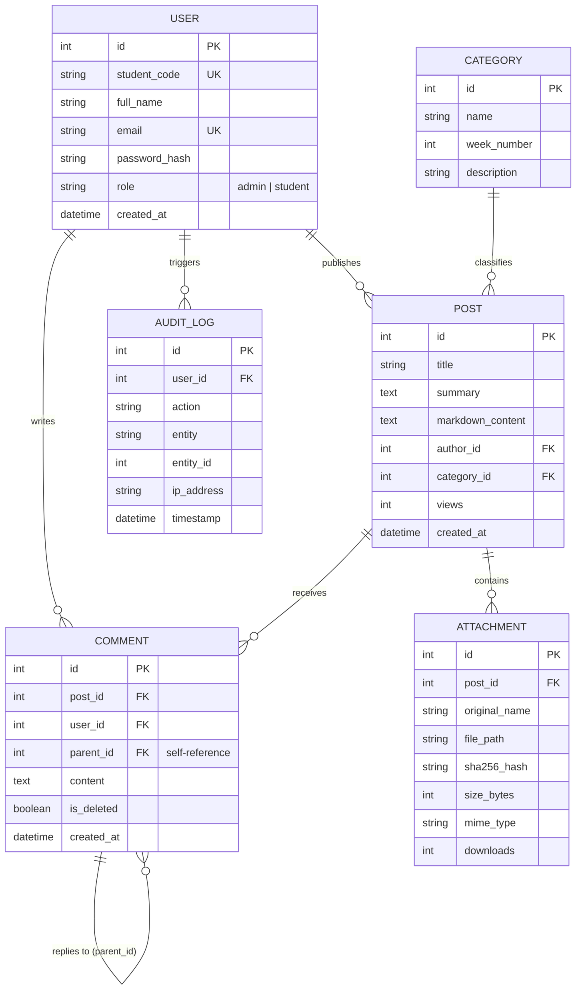

# TGS-Hub (Syntropy)

> **Plataforma Académica Colaborativa y Sistema de Gestión del Conocimiento para Teoría General de Sistemas (TGS)**  
> **Collaborative Academic Platform & Knowledge Management System for General Systems Theory (GST)**  
> Paradigma sistémico / Systemic Paradigm: **Entradas/Inputs ➔ Procesamiento/Processing ➔ Salidas/Outputs ➔ Retroalimentación/Feedback**

[](https://react.dev/)
[](https://www.python.org/)
[](https://vitejs.dev/)
[](https://fastapi.tiangolo.com/)
[](https://www.sqlalchemy.org/)
[](https://www.sqlite.org/)

---

### 🌐 Idioma / Language
* [🇪🇸 Español](#-versión-en-español)
* [🇺🇸 English](#-english-version)

---

# 🇪🇸 Versión en Español

## 📌 Tabla de Contenidos
1. [Visión y Principios del Proyecto](#-visión-y-principios-del-proyecto)
2. [Stack Tecnológico](#-stack-tecnológico)
3. [Arquitectura del Sistema](#-arquitectura-del-sistema)
4. [Estructura del Proyecto](#-estructura-del-proyecto)
5. [Guía de Inicio Rápido (Quickstart)](#-guía-de-inicio-rápido-quickstart)
6. [Credenciales por Defecto (Seeder)](#-credenciales-por-defecto-seeder)
7. [Variables de Entorno](#-variables-de-entorno)
8. [Sistema de Diseño y Temas](#-sistema-de-diseño-y-temas)
9. [Seguridad y Gestión de Archivos](#-seguridad-y-gestión-de-archivos)
10. [Plan de Ejecución y Estado del Roadmap](#-plan-de-ejecución-y-estado-del-roadmap)

---

## 🔬 Visión y Principios del Proyecto

**TGS-Hub (Syntropy)** es una plataforma académica creada para estudiantes de Ingeniería y Administración. Modela la interacción y el debate académico a través de los principios fundamentales de la Teoría General de Sistemas:

* **Entradas (Inputs):** Exploración y recepción de publicaciones, lecturas académicas y datasets.
* **Procesamiento:** Análisis, síntesis y contextualización de conceptos sistémicos mediante editor Markdown enriquecido.
* **Salidas (Outputs):** Publicación de artículos, trabajos de investigación y repositorios de archivos adjuntos (.pdf, .py, .docx, .csv, etc.).
* **Retroalimentación (Feedback):** Hilos de comentarios anidados, auditoría de interacciones y reacciones académicas tipadas (`aporte_valioso`, `duda`, `excelente_analisis`).

---

## 🛠️ Stack Tecnológico

### Frontend
* **Core:** [React 19](https://react.dev/) + [Vite](https://vitejs.dev/)
* **Enrutamiento:** [React Router v7](https://reactrouter.com/)
* **Gestión de Estado:** [Zustand](https://zustand-demo.pmnd.rs/)
* **Cliente HTTP:** [Axios](https://axios-http.com/) con interceptores JWT automáticos
* **Edición y Contenido:** `@uiw/react-md-editor`, `react-syntax-highlighter`
* **Archivos y Visualización:** `react-dropzone`, `react-pdf`
* **Métricas y Visualización:** `recharts`, `lucide-react`
* **Estilizado:** CSS nativo con variables tokens (`tokens.css`, `typography.css`)

### Backend
* **Framework:** [FastAPI](https://fastapi.tiangolo.com/) (Python 3.11+)
* **Servidor ASGI:** [Uvicorn](https://www.uvicorn.org/)
* **ORM:** [SQLAlchemy 2.0](https://www.sqlalchemy.org/)
* **Base de Datos:** SQLite (configurable a PostgreSQL mediante `DATABASE_URL`)
* **Validación de Datos:** [Pydantic v2](https://docs.pydantic.dev/) + `pydantic-settings`
* **Seguridad:** Autenticación JWT (`python-jose`), hashing de contraseñas con `passlib[bcrypt]` (factor de costo 12)
* **Gestión Multimedia & Archivos:** `aiofiles`, `Pillow` (generación de miniaturas), validación de hash SHA-256

---

## 🏛️ Arquitectura del Sistema

El proyecto sigue una arquitectura desacoplada cliente-servidor orientada a servicios y flujo sistémico (**Entrada ➔ Procesamiento ➔ Salida ➔ Feedback**), conectada mediante una API REST protegida por tokens Bearer JWT:

```mermaid
flowchart LR
    %% Clases y Estilos
    classDef userNode fill:#1f2937,stroke:#3b82f6,stroke-width:2px,color:#f3f4f6;
    classDef clientNode fill:#111827,stroke:#38bdf8,stroke-width:1px,color:#e5e7eb;
    classDef serverNode fill:#0f172a,stroke:#10b981,stroke-width:1px,color:#e5e7eb;
    classDef dataNode fill:#18181b,stroke:#f59e0b,stroke-width:1px,color:#e5e7eb;

    User(["👤 Usuario / Estudiante"]):::userNode

    subgraph FE ["Capas de Presentación (Frontend — React 19 + Vite)"]
        UI["AppShell & Vistas<br/>(Dashboard, Editor, Feed)"]:::clientNode
        State["Estado & Store<br/>(Zustand authStore)"]:::clientNode
        Themes["Tokens de Diseño<br/>(tokens.css / 3 Temas)"]:::clientNode
        ClientHTTP["Cliente Axios<br/>(JWT Interceptor)"]:::clientNode

        Themes -.-> UI
        UI <--> State
        State --> ClientHTTP
    end

    subgraph BE ["Servicios y Lógica de Negocio (Backend — FastAPI)"]
        Gatekeeper["Seguridad & Auth<br/>(OAuth2 / JWT / Bcrypt)"]:::serverNode
        
        subgraph Routers ["Routers & Endpoints"]
            R_Auth["/auth"]:::serverNode
            R_Posts["/posts"]:::serverNode
            R_Files["/files"]:::serverNode
            R_Comm["/comments"]:::serverNode
        end

        subgraph Services ["Servicios Core"]
            S_Post["PostService"]:::serverNode
            S_File["FileService<br/>(SHA-256 / Chunks)"]:::serverNode
            S_Audit["Auditoría & Logs"]:::serverNode
        end

        Gatekeeper --> Routers
        R_Posts --> S_Post
        R_Files --> S_File
        R_Comm --> S_Audit
    end

    subgraph Storage ["Almacenamiento y Persistencia"]
        FileSystem[("Sistema de Archivos<br/>/uploads")]:::dataNode
        DB[("Base de Datos Relacional<br/>SQLite / PostgreSQL")]:::dataNode
    end

    %% Conexiones principales
    User -->|"Interacciones UI / Events"| UI
    ClientHTTP -->|"HTTP REST / JSON & Multipart"| Gatekeeper
    S_File -->|"Stream I/O & Thumbnails"| FileSystem
    S_Post & S_File & S_Audit -->|"SQLAlchemy ORM"| DB
```



### 🗄️ Modelo Relacional del Ecosistema



---

## 📂 Estructura del Proyecto

```text
Syntropy/
├── backend/
│   ├── app/
│   │   ├── core/               # Configuración, DB engine y utilidades de seguridad JWT
│   │   ├── models/             # Modelos ORM (User, Post, Categoria, Archivo, Comentario, Audit)
│   │   ├── schemas/            # Esquemas Pydantic para validación y serialización
│   │   ├── repositories/       # Abstracciones de acceso a datos
│   │   ├── services/           # Lógica de negocio (FileService con SHA-256, PostService)
│   │   ├── routers/            # Controladores de rutas (auth, posts, files, comments)
│   │   └── main.py             # Inicialización de FastAPI, CORS y montaje estático
│   ├── uploads/                # Directorio de almacenamiento físico de archivos
│   ├── seed_tgs_data.py        # Poblador de datos realistas para el entorno académico
│   ├── requirements.txt        # Dependencias Python
│   └── .env.example            # Plantilla de variables de entorno del backend
├── frontend/
│   ├── src/
│   │   ├── components/         # Componentes modulares (layout, ui, posts, files, comments)
│   │   ├── design/             # Tokens CSS multi-tema y escalas tipográficas
│   │   ├── hooks/              # Custom hooks (useAuth, useTheme, usePosts, useFiles)
│   │   ├── pages/              # Vistas principales (Dashboard, Login, Register, Profile, etc.)
│   │   ├── services/           # Cliente Axios con inyección de Bearer Token
│   │   ├── store/              # Estado global con Zustand (authStore)
│   │   ├── App.jsx             # Enrutador principal y Guards de autenticación
│   │   └── main.jsx            # Punto de entrada de la aplicación
│   └── package.json            # Scripts y dependencias del frontend
├── tgs_hub_execution_plan.md   # Especificación arquitectónica y plan maestro de 12 fases
└── README.md                   # Documentación técnica general
```

---

## 🚀 Guía de Inicio Rápido (Quickstart)

### Prerrequisitos
* **Python**: 3.11 o superior
* **Node.js**: 20 o superior
* **Gestor de paquetes Node**: `pnpm` o `npm`

---

### 1. Configuración del Backend

1. Entra al directorio del backend y crea un entorno virtual:
   ```bash
   cd backend
   python -m venv .venv
   ```

2. Activa el entorno virtual:
   * **Windows (PowerShell):**
     ```powershell
     .\.venv\Scripts\Activate.ps1
     ```
   * **Linux / macOS:**
     ```bash
     source .venv/bin/activate
     ```

3. Instala las dependencias:
   ```bash
   pip install -r requirements.txt
   ```

4. Configura el archivo de variables de entorno:
   ```bash
   cp .env.example .env
   ```

5. Ejecuta el seeder para inicializar la base de datos con categorías de semanas TGS, usuarios de prueba y posts académicos:
   ```bash
   python seed_tgs_data.py
   ```

6. Inicia el servidor de desarrollo:
   ```bash
   uvicorn app.main:app --reload --port 8000
   ```
   * *Documentación interactiva Swagger:* [http://localhost:8000/docs](http://localhost:8000/docs)
   * *Healthcheck:* [http://localhost:8000/health](http://localhost:8000/health)

---

### 2. Configuración del Frontend

1. Abre una nueva terminal, dirígete a la carpeta `frontend` e instala dependencias:
   ```bash
   cd frontend
   pnpm install
   # o bien: npm install
   ```

2. Inicia el servidor de desarrollo con Vite:
   ```bash
   pnpm dev
   # o bien: npm run dev
   ```

3. Abre tu navegador en [http://localhost:5173](http://localhost:5173).

---

## 🔑 Credenciales por Defecto (Seeder)

El script `seed_tgs_data.py` genera cuentas de prueba preconfiguradas:

| Rol | Código / Usuario | Contraseña | Nombre |
|---|---|---|---|
| **Administrador** | `61035728` | `271714` | Docente Administrador TGS |
| **Estudiante** | `20241001` | `password123` | Carlos Mendoza |
| **Estudiante** | `20241002` | `password123` | Valeria Quispe |

> Se crean además 10 categorías académicas (correspondientes a las Semanas 1 a 10 de la asignatura: Bertalanffy, Cibernética, Entropía, Homeostasis, etc.), 20 publicaciones con Markdown enriquecido y archivos adjuntos de prueba.

---

## ⚙️ Variables de Entorno

### Backend (`backend/.env`)

| Variable | Tipo | Descripción | Valor por Defecto |
|---|---|---|---|
| `SECRET_KEY` | `str` | Clave secreta para firmar tokens JWT (se recomienda generar con openssl) | *Clave temporal de desarrollo* |
| `DATABASE_URL` | `str` | Cadena de conexión SQLAlchemy (SQLite o PostgreSQL) | `sqlite:///./tgs_hub.db` |
| `UPLOAD_DIR` | `str` | Directorio local de destino para archivos subidos | `uploads` |
| `MAX_FILE_MB` | `int` | Tamaño máximo permitido por archivo (MB) | `100` |
| `ALLOWED_EXTENSIONS`| `str` | Lista separada por comas de formatos autorizados | `pdf,docx,pptx,xlsx,txt,csv,png,jpg,py,zip...` |
| `CORS_ORIGINS` | `str` | Orígenes web permitidos para peticiones cruzadas | `http://localhost:5173,http://localhost:3000` |
| `ACCESS_TOKEN_EXPIRE_DAYS` | `int` | Vigencia de la sesión en días | `7` |

---

## 🎨 Sistema de Diseño y Temas

La interfaz se concibió bajo las pautas de **`frontend-design`** e **`impeccable`**, priorizando un estilo *Academic Tech / Cyber-Systemic* que descarta los clichés de SaaS genéricos.

### Modos Soportados
1. **Dark Matte (Predeterminado):** Fondo carbón profundo (`#0D1117`), superficies `#161B22` y bordes sutiles `#21262D`.
2. **Academic Paper (Claro):** Fondo `#FAFBFC`, superficies blancas puras y contrastes tipográficos para lectura prolongada.
3. **Deep Cyber Navy:** Paleta azul marino nocturna (`#060D1F` / `#0B1629`) con acentos cian y esmeralda.

### Tipografías
* **UI y Lectura General:** *Plus Jakarta Sans* (pesos 300, 400, 500, 600)
* **Datos Técnicos, Hashes y Código:** *JetBrains Mono* (pesos 400, 500)

---

## 🔒 Seguridad y Gestión de Archivos

* **Hashing Criptográfico:** Cada archivo cargado se procesa en bloques de 8 KB generando su huella **SHA-256** para certificar integridad y detectar duplicados.
* **Control de Formatos:** Doble validación (extensión autorizada y verificación de tipos MIME).
* **Control de Acceso Basado en Roles (RBAC):** Dependencias FastAPI para aislar permisos entre estudiantes y docentes administradores (`require_role("admin")`).
* **Visualización sin descarga forzosa:** Endpoints dedicados para streaming inline (`Content-Disposition: inline`) para el previsualizador universal.

---

## 🗺️ Plan de Ejecución y Estado del Roadmap

El proyecto sigue el plan estructurado en 12 fases detallado en [tgs_hub_execution_plan.md](file:///c:/PROYECTOS/FULL%20STACK/Syntropy/tgs_hub_execution_plan.md):

* [x] **P1 — Fundación del Sistema:** Tokens de diseño, fuentes y estructura de directorios.
* [x] **P2 — Backend Core:** Modelos ORM, esquemas Pydantic, Auth JWT y Seeder TGS.
* [x] **P3 — Backend API (Posts y Archivos):** Endpoints REST para publicaciones y gestión de archivos.
* [ ] **P4 — Backend API (Comentarios y Auditoría):** Hilos recursivos, reacciones académicas y logs de auditoría.
* [x] **P5 — Frontend Shell:** AppShell, glassmorphism Header, Sidebar con flujo TGS y ThemeSwitcher.
* [x] **P6 — Frontend Auth:** Páginas de Login, Registro y guardias de ruta (`ProtectedRoute`). *(Perfil en desarrollo)*.
* [ ] **P7 — Frontend Dashboard y Feed:** KPIs sistémicos y feed con filtrado por semanas TGS.
* [ ] **P8 — Frontend Editor y Gestor de Archivos:** Editor Markdown en vivo y Dropzone con drag & drop.
* [ ] **P9 — Frontend Debate y Comentarios:** Hilos interactivos de discusión y reacciones académicas.
* [ ] **P10 — Analíticas y Explorador:** Gráficos con Recharts, diagrama interactivo de flujo y navegador de archivos.
* [ ] **P11 — Previsualizador Universal:** Modal de lectura para PDF, código fuente, imágenes y hash SHA-256.
* [ ] **P12 — QA, Accesibilidad y Cierre:** Auditoría de contraste, soporte móvil responsivo total y optimización.

---

## 📄 Licencia

Este proyecto se distribuye para fines académicos e investigativos en el marco del estudio de la **Teoría General de Sistemas**.

---
---

# 🇺🇸 English Version

## 📌 Table of Contents
1. [Project Vision & Core Principles](#-project-vision--core-principles)
2. [Technology Stack](#-technology-stack)
3. [System Architecture](#-system-architecture)
4. [Project Structure](#-project-structure)
5. [Quickstart Guide](#-quickstart-guide)
6. [Default Credentials (Seeder)](#-default-credentials-seeder)
7. [Environment Variables](#-environment-variables)
8. [Design System & Theming](#-design-system--theming)
9. [Security & File Management](#-security--file-management)
10. [Execution Plan & Roadmap Status](#-execution-plan--roadmap-status)

---

## 🔬 Project Vision & Core Principles

**TGS-Hub (Syntropy)** is an academic platform designed for Engineering and Management students. It models academic interaction and debate through the core pillars of General Systems Theory (GST):

* **Inputs:** Exploration and intake of academic papers, student posts, and data sets.
* **Processing:** Analysis, synthesis, and contextualization of systemic concepts using a rich Markdown editor.
* **Outputs:** Publishing research articles, assignments, and multi-format attachment repositories (.pdf, .py, .docx, .csv, etc.).
* **Feedback:** Nested discussion threads, interaction audit logs, and typed academic reactions (`valuable_contribution`, `inquiry`, `insightful_analysis`).

---

## 🛠️ Technology Stack

### Frontend
* **Core:** [React 19](https://react.dev/) + [Vite](https://vitejs.dev/)
* **Routing:** [React Router v7](https://reactrouter.com/)
* **State Management:** [Zustand](https://zustand-demo.pmnd.rs/)
* **HTTP Client:** [Axios](https://axios-http.com/) with automatic JWT interceptors
* **Editor & Content:** `@uiw/react-md-editor`, `react-syntax-highlighter`
* **File Handling & Preview:** `react-dropzone`, `react-pdf`
* **Metrics & Visuals:** `recharts`, `lucide-react`
* **Styling:** Native CSS powered by Design Tokens (`tokens.css`, `typography.css`)

### Backend
* **Framework:** [FastAPI](https://fastapi.tiangolo.com/) (Python 3.11+)
* **ASGI Server:** [Uvicorn](https://www.uvicorn.org/)
* **ORM:** [SQLAlchemy 2.0](https://www.sqlalchemy.org/)
* **Database:** SQLite (readily configurable to PostgreSQL via `DATABASE_URL`)
* **Data Validation:** [Pydantic v2](https://docs.pydantic.dev/) + `pydantic-settings`
* **Security:** JWT authentication (`python-jose`), password hashing with `passlib[bcrypt]` (cost factor 12)
* **Multimedia & File Storage:** `aiofiles`, `Pillow` (thumbnail generation), SHA-256 hash checksum validation

---

## 🏛️ System Architecture

The project follows a decoupled client-server architecture centered around services and systemic flow (**Inputs ➔ Processing ➔ Outputs ➔ Feedback**), connected via a REST API secured by Bearer JWT tokens:

```mermaid
flowchart LR
    %% Classes & Styles
    classDef userNode fill:#1f2937,stroke:#3b82f6,stroke-width:2px,color:#f3f4f6;
    classDef clientNode fill:#111827,stroke:#38bdf8,stroke-width:1px,color:#e5e7eb;
    classDef serverNode fill:#0f172a,stroke:#10b981,stroke-width:1px,color:#e5e7eb;
    classDef dataNode fill:#18181b,stroke:#f59e0b,stroke-width:1px,color:#e5e7eb;

    User(["👤 User / Student"]):::userNode

    subgraph FE ["Presentation Layers (Frontend — React 19 + Vite)"]
        UI["AppShell & Views<br/>(Dashboard, Editor, Feed)"]:::clientNode
        State["State & Store<br/>(Zustand authStore)"]:::clientNode
        Themes["Design Tokens<br/>(tokens.css / 3 Themes)"]:::clientNode
        ClientHTTP["Axios Client<br/>(JWT Interceptor)"]:::clientNode

        Themes -.-> UI
        UI <--> State
        State --> ClientHTTP
    end

    subgraph BE ["Business Logic & Services (Backend — FastAPI)"]
        Gatekeeper["Security & Auth<br/>(OAuth2 / JWT / Bcrypt)"]:::serverNode
        
        subgraph Routers ["Routers & Endpoints"]
            R_Auth["/auth"]:::serverNode
            R_Posts["/posts"]:::serverNode
            R_Files["/files"]:::serverNode
            R_Comm["/comments"]:::serverNode
        end

        subgraph Services ["Core Services"]
            S_Post["PostService"]:::serverNode
            S_File["FileService<br/>(SHA-256 / Chunks)"]:::serverNode
            S_Audit["Audit & Logs"]:::serverNode
        end

        Gatekeeper --> Routers
        R_Posts --> S_Post
        R_Files --> S_File
        R_Comm --> S_Audit
    end

    subgraph Storage ["Storage & Persistence"]
        FileSystem[("File System<br/>/uploads")]:::dataNode
        DB[("Relational Database<br/>SQLite / PostgreSQL")]:::dataNode
    end

    %% Connections
    User -->|"UI Interactions / Events"| UI
    ClientHTTP -->|"HTTP REST / JSON & Multipart"| Gatekeeper
    S_File -->|"Stream I/O & Thumbnails"| FileSystem
    S_Post & S_File & S_Audit -->|"SQLAlchemy ORM"| DB
```



### 🗄️ Relational Entity Model



---

## 📂 Project Structure

```text
Syntropy/
├── backend/
│   ├── app/
│   │   ├── core/               # Configuration, DB engine & JWT security helpers
│   │   ├── models/             # ORM models (User, Post, Categoria, Archivo, Comentario, Audit)
│   │   ├── schemas/            # Pydantic validation & serialization schemas
│   │   ├── repositories/       # Data access abstractions
│   │   ├── services/           # Business logic (FileService with SHA-256, PostService)
│   │   ├── routers/            # Route controllers (auth, posts, files, comments)
│   │   └── main.py             # FastAPI entrypoint, CORS configuration & static mount
│   ├── uploads/                # Physical file storage directory
│   ├── seed_tgs_data.py        # Realistic database seeder for academic simulation
│   ├── requirements.txt        # Python package dependencies
│   └── .env.example            # Environment variables template
├── frontend/
│   ├── src/
│   │   ├── components/         # Modular UI components (layout, ui, posts, files, comments)
│   │   ├── design/             # Multi-theme CSS tokens & typography scale
│   │   ├── hooks/              # Custom React hooks (useAuth, useTheme, usePosts, useFiles)
│   │   ├── pages/              # Main view pages (Dashboard, Login, Register, Profile, etc.)
│   │   ├── services/           # Axios client configured with Bearer Token interceptor
│   │   ├── store/              # Global state with Zustand (authStore)
│   │   ├── App.jsx             # Main router configuration & Protected Route Guards
│   │   └── main.jsx            # Application entrypoint
│   └── package.json            # Node scripts & frontend dependencies
├── tgs_hub_execution_plan.md   # Architectural specification & 12-phase master plan
└── README.md                   # Comprehensive technical documentation
```

---

## 🚀 Quickstart Guide

### Prerequisites
* **Python**: 3.11 or higher
* **Node.js**: 20 or higher
* **Node package manager**: `pnpm` or `npm`

---

### 1. Backend Setup

1. Navigate to the backend directory and set up a virtual environment:
   ```bash
   cd backend
   python -m venv .venv
   ```

2. Activate the virtual environment:
   * **Windows (PowerShell):**
     ```powershell
     .\.venv\Scripts\Activate.ps1
     ```
   * **Linux / macOS:**
     ```bash
     source .venv/bin/activate
     ```

3. Install requirements:
   ```bash
   pip install -r requirements.txt
   ```

4. Create your local environment file:
   ```bash
   cp .env.example .env
   ```

5. Run the database seeder to populate courses, GST weeks, seed accounts, and academic posts:
   ```bash
   python seed_tgs_data.py
   ```

6. Launch the development server:
   ```bash
   uvicorn app.main:app --reload --port 8000
   ```
   * *Swagger Interactive Docs:* [http://localhost:8000/docs](http://localhost:8000/docs)
   * *Healthcheck Endpoint:* [http://localhost:8000/health](http://localhost:8000/health)

---

### 2. Frontend Setup

1. Open a new terminal session, navigate to the `frontend` folder, and install dependencies:
   ```bash
   cd frontend
   pnpm install
   # or: npm install
   ```

2. Start the Vite development server:
   ```bash
   pnpm dev
   # or: npm run dev
   ```

3. Open your browser at [http://localhost:5173](http://localhost:5173).

---

## 🔑 Default Credentials (Seeder)

The `seed_tgs_data.py` script provisions pre-configured academic profiles:

| Role | Student ID / Username | Password | Full Name |
|---|---|---|---|
| **Administrator** | `61035728` | `271714` | Docente Administrador TGS |
| **Student** | `20241001` | `password123` | Carlos Mendoza |
| **Student** | `20241002` | `password123` | Valeria Quispe |

> Also sets up 10 syllabus categories (Weeks 1 to 10: Bertalanffy, Cybernetics, Entropy, Homeostasis, etc.), 20 enriched Markdown posts, and sample attachments.

---

## ⚙️ Environment Variables

### Backend (`backend/.env`)

| Variable | Type | Description | Default Value |
|---|---|---|---|
| `SECRET_KEY` | `str` | Secret key for signing JWT tokens (generate via openssl for prod) | *Development placeholder* |
| `DATABASE_URL` | `str` | SQLAlchemy connection string (SQLite or PostgreSQL) | `sqlite:///./tgs_hub.db` |
| `UPLOAD_DIR` | `str` | Storage folder for uploaded files | `uploads` |
| `MAX_FILE_MB` | `int` | Maximum allowed file size in MB | `100` |
| `ALLOWED_EXTENSIONS`| `str` | Comma-separated list of permitted extensions | `pdf,docx,pptx,xlsx,txt,csv,png,jpg,py,zip...` |
| `CORS_ORIGINS` | `str` | Allowed origin URLs for Cross-Origin requests | `http://localhost:5173,http://localhost:3000` |
| `ACCESS_TOKEN_EXPIRE_DAYS` | `int` | Token expiration time in days | `7` |

---

## 🎨 Design System & Theming

Designed intentionally under **`frontend-design`** and **`impeccable`** guidelines, sporting a bespoke *Academic Tech / Cyber-Systemic* visual language rather than generic SaaS templates.

### Supported Themes
1. **Dark Matte (Default):** Deep carbon root (`#0D1117`), card surfaces `#161B22`, and structured boundaries `#21262D`.
2. **Academic Paper (Light):** Crisp `#FAFBFC` canvas with pure white cards tailored for sustained reading.
3. **Deep Cyber Navy:** Night-time deep navy palette (`#060D1F` / `#0B1629`) with cyan and emerald accents.

### Typography
* **UI & Body Copy:** *Plus Jakarta Sans* (weights 300, 400, 500, 600)
* **Metadata, Hashes & Code:** *JetBrains Mono* (weights 400, 500)

---

## 🔒 Security & File Management

* **Cryptographic Hashing:** Every file uploaded is streamed in 8 KB chunks to compute its **SHA-256** checksum for duplicate detection and tamper verification.
* **Format Control:** Dual validation pipeline (extension check + MIME type inspection).
* **Role-Based Access Control (RBAC):** FastAPI dependencies enforce separation between regular students and faculty administrators (`require_role("admin")`).
* **In-browser Preview:** Dedicated inline streaming endpoints (`Content-Disposition: inline`) enabling previewing without compulsory downloads.

---

## 🗺️ Execution Plan & Roadmap Status

The project roadmap comprises 12 distinct phases detailed in [tgs_hub_execution_plan.md](file:///c:/PROYECTOS/FULL%20STACK/Syntropy/tgs_hub_execution_plan.md):

* [x] **P1 — System Foundation:** Design tokens, typography setup, and directory architecture.
* [x] **P2 — Backend Core:** ORM models, Pydantic schemas, JWT authentication, and TGS Seeder.
* [x] **P3 — Backend API (Posts & Files):** REST endpoints for post management and secure file uploading.
* [ ] **P4 — Backend API (Comments & Audit):** Recursive threads, academic reactions, and audit logging.
* [x] **P5 — Frontend Shell:** AppShell layout, glassmorphic Header, systemic flow Sidebar, and ThemeSwitcher.
* [x] **P6 — Frontend Auth:** Login & Register pages and route protection guards (`ProtectedRoute`). *(Profile under development)*.
* [ ] **P7 — Frontend Dashboard & Feed:** System KPIs and post feed with syllabus filtering.
* [ ] **P8 — Frontend Editor & File Manager:** Live Markdown editor and interactive Drag & Drop dropzone.
* [ ] **P9 — Frontend Academic Debate:** Threaded nested comments and typed reaction triggers.
* [ ] **P10 — Analytics & File Explorer:** Recharts visual charts, interactive GST flow diagram, and file browser.
* [ ] **P11 — Universal File Previewer:** Multi-format modal for PDF, source code, images, and SHA-256 verification.
* [ ] **P12 — QA, Accessibility & Wrap-up:** Contrast audit, end-to-end responsiveness, and final optimizations.

---

## 📄 License

This software is distributed for academic, educational, and research purposes under the study of **General Systems Theory**.
